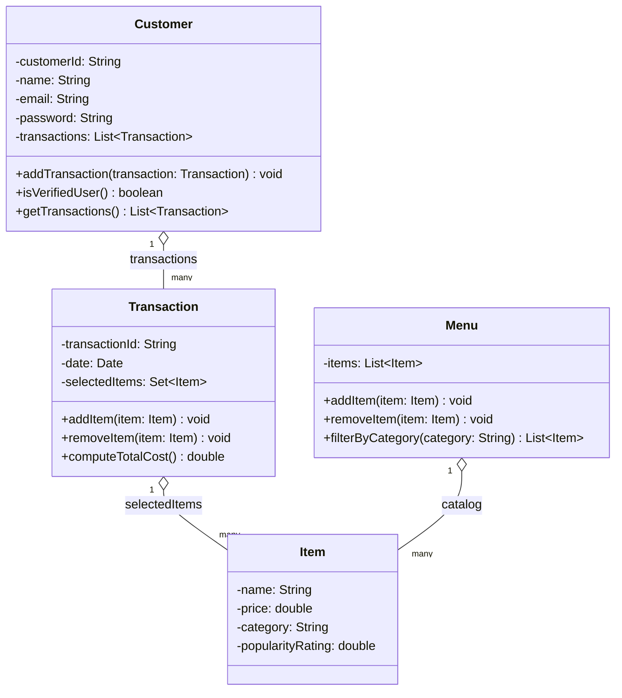

# ByteBites Class Diagram

Derived from [bytebites_spec.md](../bytebites_spec.md), per the constraints in
[ByteBites_Design_Reference.md](../ByteBites_Design_Reference.md).

## Design notes / traceability

| Spec requirement | Modeled as |
|---|---|
| "tracking their names and their past purchase history so the system can verify they are real users" | `Customer.name`, `Customer.transactions`, `Customer.isVerifiedUser()` |
| "track the name, price, category, and popularity rating for every item" | `Item` fields (`popularityRating` fixed at creation) |
| "a digital list that holds all items and lets us filter by category" | `Menu` |
| "group them into a single transaction... store the selected items and compute the total cost" | `Transaction.selectedItems` (a `Set`, distinct items only), `Transaction.computeTotalCost()` |
| Customer login fields (no history class, no auth logic per reference file) | `Customer.email`, `Customer.password` as plain data fields |

## Open questions (unchanged from prior revision)

- **`isVerifiedUser()`**: check definition still unspecified — assumed non-empty `transactions`, could instead check `email`/`password` are set.
- **`selectedItems` as a `Set`**: a `Transaction` can't represent quantities (e.g. "2x Spicy Burger"), only presence/absence of each item.
